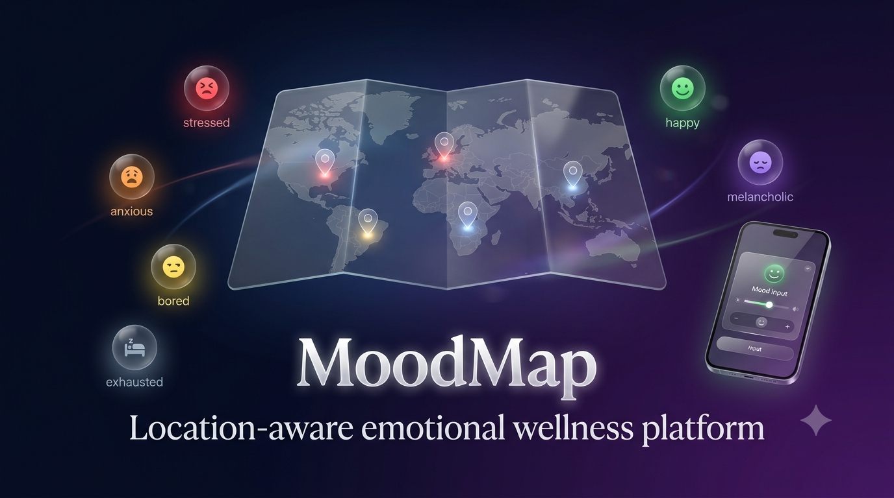
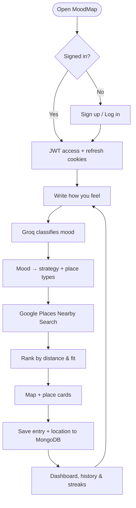
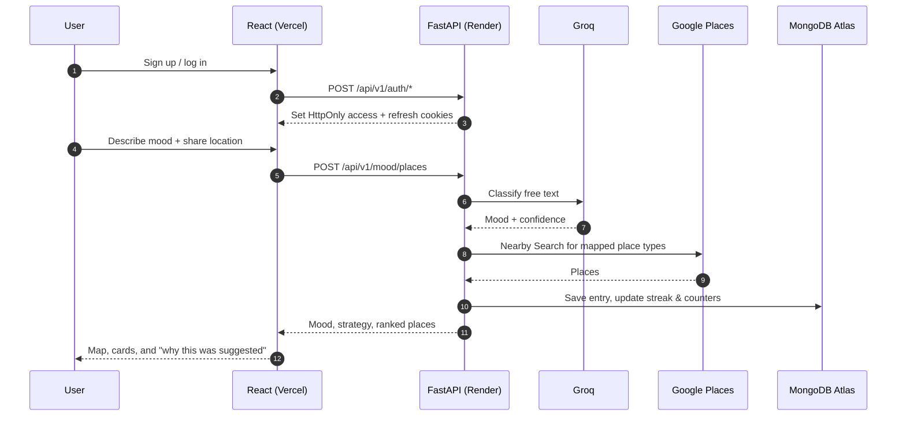

<p align="center">
  
</p>

<p align="center">
  <a href="https://mood-map-sigma.vercel.app/">
    
  </a>
</p>

<p align="center">
  <a href="https://mood-map-sigma.vercel.app/"></a>
  <a href="https://github.com/chEkshith/mood-map"></a>
  
</p>

<p align="center">
  <b>MoodMap</b> is a location-aware emotional wellness platform. Write a sentence about how you feel and it finds nearby places suited to help you <i>reset</i>, <i>shift</i>, or <i>match</i> your mood — then keeps a quiet record so patterns become visible.
</p>

---

## ✨ Features

| Area | What it does |
|---|---|
| **Mood check-ins** | Free-text journaling; no long questionnaire. Groq's `openai/gpt-oss-20b` classifies the tone into one of six moods. |
| **Prompt safety** | Explicit, criminal, or partner-seeking requests are declined with a polite message instead of returning places. |
| **Smart place matching** | Each mood maps to a strategy and Google Place types, then nearby results are ranked by distance and fit. |
| **Interactive map** | Leaflet + OpenStreetMap view with mood-filtered place pins and detail drawers. |
| **Place cards & photos** | Curated cards with ratings, opening hours, distance, and Cloudinary-cached photos. |
| **History** | Every check-in is stored in MongoDB and can be filtered, revisited, or deleted. |
| **Dashboard & stats** | Mood distribution, strategy mix, streaks, and total entries with animated charts and counters. |
| **Accounts & profiles** | JWT auth via HttpOnly cookies, avatars via Cloudinary, display-name updates, password changes, and account deletion. |
| **Polished UX** | Aurora/video backgrounds, glassmorphism, intro splash, emoji rain, toast notifications, and reduced-motion-friendly animations. |
| **SEO & link previews** | Open Graph + Twitter cards, canonical URL, favicon, sitemap, robots, and Google site verification. |

---

## 🧭 How it works





---

## 🧠 Mood → place strategy

| Mood | Strategy | Place types | Intent |
|---|---|---|---|
| Stressed | Reset | park, spa, library, yoga studio | Calm, low-stimulation spaces for decompression |
| Anxious | Shift | bookstore, library, park, botanical garden | Gentle warmth without overwhelming stimulation |
| Bored | Match | museum, movie theater, video arcade, art gallery | Novelty and engagement to break the flatness |
| Exhausted | Reset | park, spa, library, bookstore | Restorative, low-energy environments |
| Happy | Match | restaurant, café, park, art gallery | Vibrant social spaces to sustain your mood |
| Melancholic | Shift | bookstore, park, museum, art gallery | Beautiful, gentle spaces that honour and lift |

---

## 🛠 Tech stack

### Frontend
<p>
  
  
  
  
  
  
  
  
  
</p>

### Backend
<p>
  
  
  
  
  
  
  
  
  
</p>

### Infrastructure & tooling
<p>
  
  
  
  
  
  
  
</p>

---

## 🏗 Architecture

MoodMap is a monorepo with two deployables:

- **`frontend/`** — React 18 + TypeScript SPA built with Vite, routed by React Router, styled with Tailwind CSS, state in Zustand, maps via react-leaflet, charts via Recharts, HTTP via Axios. Deployed on **Vercel**.
- **`backend/`** — FastAPI (Python 3.11) with Motor for async MongoDB, Groq for mood classification, Google Places API (New) for nearby search, Cloudinary for image caching, JWT auth in HttpOnly cookies, SlowAPI rate limiting, and optional Sentry. Deployed on **Render**.
- **Database** — MongoDB Atlas, with a unique email index, a `(user_id, created_at)` history index, a `2dsphere` location index, and a TTL index for refresh tokens.

### Authentication flow

1. `POST /auth/signup` or `POST /auth/login` creates an access token (15 min) and a refresh token (7 days).
2. Both tokens are stored as HttpOnly cookies (`Secure` + `SameSite=None` in production so Vercel → Render works).
3. Refresh tokens are persisted in MongoDB and rotated via `POST /auth/refresh`; logout revokes the token and clears cookies.
4. Axios automatically retries a single 401 after refreshing the session.

### Frontend routes

| Route | Access | Page |
|---|---|---|
| `/` | Public | Landing page |
| `/login` | Public | Log in |
| `/signup` | Public | Create account |
| `/app` | Protected | Mood check-in + map + place results |
| `/dashboard` | Protected | Stats, charts, streaks |
| `/history` | Protected | Past check-ins with filters |
| `/profile` | Protected | Profile, avatar, password, account |
| `/about` | Protected | Project and developer info |
| `*` | Public | 404 |

---

## 🔌 API overview

Base URL: `/api/v1` — interactive docs at `/docs`.

| Method | Endpoint | Description |
|---|---|---|
| `POST` | `/auth/signup` | Create an account and issue cookies |
| `POST` | `/auth/login` | Log in and issue cookies |
| `POST` | `/auth/logout` | Revoke refresh token and clear cookies |
| `GET` | `/auth/me` | Current user profile |
| `POST` | `/auth/refresh` | Rotate the access/refresh token pair |
| `PUT` | `/auth/profile` | Update display name |
| `POST` | `/auth/avatar` | Upload/replace avatar (multipart) |
| `DELETE` | `/auth/avatar` | Remove avatar |
| `PUT` | `/auth/change-password` | Change password |
| `DELETE` | `/auth/account` | Delete account and associated data |
| `POST` | `/mood/places` | Classify mood and return nearby places |
| `GET` | `/mood/history` | Paginated/filterable history |
| `GET` | `/mood/history/{entry_id}` | Single history entry |
| `GET` | `/mood/stats` | Mood distribution, streaks, totals |
| `DELETE` | `/mood/history/{entry_id}` | Delete a history entry |
| `GET` | `/health` | Liveness and uptime |
| `GET` | `/health/ready` | Readiness with MongoDB ping |

Mood submission is rate-limited to **15 requests/minute** per client.

---

## 🚀 Local development

### Prerequisites

- Python **3.11+**
- Node.js **20+** (the frontend declares `>=20`)
- Docker (optional)
- MongoDB Atlas cluster or a local MongoDB instance (`mongodb://127.0.0.1:27017`)

### With Docker

```bash
docker-compose up --build
```

- Frontend: http://localhost:5173
- Backend: http://localhost:8000
- API docs: http://localhost:8000/docs

### Manual

**Backend**

```bash
cd backend
python -m venv .venv

# macOS / Linux
source .venv/bin/activate
# Windows (PowerShell)
# .venv\Scripts\Activate.ps1

pip install -r requirements.txt
cp .env.example .env   # Windows: copy .env.example .env
uvicorn app.main:app --reload --port 8000
```

**Frontend**

```bash
cd frontend
npm install
npm run dev
```

Vite proxies `/api` to `http://localhost:8000`, so leave `VITE_API_URL` empty locally.

### Useful scripts

| Location | Command | Purpose |
|---|---|---|
| `frontend/` | `npm run dev` | Start Vite dev server |
| `frontend/` | `npm run build` | Type-check + production build to `dist/` |
| `frontend/` | `npm run preview` | Preview the production build |
| `frontend/` | `npm run lint` | ESLint |
| `frontend/` | `npm run type-check` | `tsc --noEmit` |
| `frontend/` | `npm run test` | Vitest |
| `backend/` | `pytest tests -v` | Backend unit + integration tests |
| `backend/` | `ruff check .` | Lint |
| `backend/` | `ruff format --check .` | Format check |

---

## 🔐 Environment variables

### Backend (`backend/.env`)

| Variable | Required | Description |
|---|---|---|
| `GROQ_API_KEY` | Yes | Groq API key for mood classification |
| `GOOGLE_PLACES_API_KEY` | Yes | Google Places API (New) key |
| `MONGODB_URI` | Yes | Atlas `mongodb+srv://...` or local `mongodb://127.0.0.1:27017` |
| `MONGODB_DB_NAME` | Yes | Database name (default `moodmap`) |
| `JWT_SECRET_KEY` | Yes | Signing secret — generate with `openssl rand -hex 32` |
| `JWT_ALGORITHM` | No | Default `HS256` |
| `JWT_ACCESS_TOKEN_EXPIRE_MINUTES` | No | Default `15` |
| `JWT_REFRESH_TOKEN_EXPIRE_DAYS` | No | Default `7` |
| `CLOUDINARY_CLOUD_NAME` | Yes | Cloudinary cloud name |
| `CLOUDINARY_API_KEY` | Yes | Cloudinary API key |
| `CLOUDINARY_API_SECRET` | Yes | Cloudinary API secret |
| `SENTRY_DSN` | No | Enables Sentry error tracking when set |
| `ENVIRONMENT` | No | `local` or `production` (production enables Secure, SameSite=None cookies) |
| `FRONTEND_URL` | Yes | Comma-separated allowed origins (e.g. `https://mood-map-sigma.vercel.app`) |

### Frontend (`frontend/.env`)

| Variable | Description |
|---|---|
| `VITE_API_URL` | Render backend origin, e.g. `https://<your-render-service>.onrender.com`. Leave empty locally. Do **not** append `/api/v1`; the client adds it automatically. |

### API keys

- **Groq** — https://console.groq.com
- **Google Places API (New)** — https://console.cloud.google.com
- **MongoDB Atlas** — https://www.mongodb.com/atlas
- **Cloudinary** — https://cloudinary.com
- **Sentry** (optional) — https://sentry.io

---

## 🌐 Deployment

| Part | Platform | Production URL |
|---|---|---|
| Frontend | Vercel | https://mood-map-sigma.vercel.app/ |
| Backend | Render | `https://<your-render-service>.onrender.com` |
| Database | MongoDB Atlas | `mongodb+srv://...` |

- **Vercel** builds from `frontend/` using `frontend/vercel.json` (`npm ci` → `npm run build` → `dist`). All SPA routes are rewritten to `index.html`, while static assets such as `og-image.jpg`, `sitemap.xml`, and `robots.txt` are served directly.
- **Render** deploys the FastAPI service from `render.yaml` (`rootDir: backend`, health check `/api/v1/health`, Python 3.11.9).
- **CI/CD** triggers the Render deploy hook after backend tests pass on `main`. Vercel deploys automatically.
- Full step-by-step instructions are in [`DEPLOY_FLOW.md`](DEPLOY_FLOW.md).

### 🔎 SEO, sitemap & link previews

The frontend ships with:

| File | Purpose |
|---|---|
| `frontend/index.html` | Title, description, canonical, favicon, Google site verification, Open Graph and Twitter card tags |
| `frontend/public/og-image.jpg` | 1200 × 630 social preview image used by all platforms |
| `frontend/public/sitemap.xml` | Public URLs: `/`, `/login`, `/signup` |
| `frontend/public/robots.txt` | Allows public pages, blocks protected app routes, points to the sitemap |

Direct checks after deployment:

- OG image — https://mood-map-sigma.vercel.app/og-image.jpg
- Sitemap — https://mood-map-sigma.vercel.app/sitemap.xml
- Robots — https://mood-map-sigma.vercel.app/robots.txt

Preview validators: [Facebook Sharing Debugger](https://developers.facebook.com/tools/debug/), [LinkedIn Post Inspector](https://www.linkedin.com/post-inspector/), [OpenGraph.xyz](https://www.opengraph.xyz/), and [Metatags.io](https://metatags.io/). For X, Telegram, Discord, Slack, WhatsApp, and iMessage, paste the live URL into a chat/composer and refresh the cache if an old preview appears.

---

## 🧪 Testing & CI/CD

| Workflow | Triggers | What it does |
|---|---|---|
| `backend-ci.yml` | Push/PR touching `backend/**` on `main`/`dev` | Ruff lint/format (advisory), pytest suite, Render deploy hook on `main` |
| `frontend-ci.yml` | Push/PR touching `frontend/**` on `main`/`dev` | `npm ci`, ESLint, `tsc --noEmit`, production build |
| `security-scan.yml` | Push to `main` and Monday cron | `safety check` for Python and `npm audit --audit-level=high` |

Backend tests live in `backend/tests/` and cover auth, mood logic, place ranking, and the mood endpoint using `mongomock`.

---

## 📁 Project structure

```text
mood-map/
├── backend/
│   ├── app/
│   │   ├── main.py                 # FastAPI app, CORS, rate limiting, error handlers
│   │   ├── config.py               # Pydantic settings
│   │   ├── db.py                   # Motor connection + indexes
│   │   ├── middleware/             # JWT cookies and current-user dependency
│   │   ├── routers/                # auth, mood, health
│   │   ├── services/               # classifier, places, mood_logic, history, cloudinary
│   │   ├── schemas/                # Pydantic request/response models
│   │   └── models/                 # User model
│   ├── tests/                      # unit + integration tests
│   ├── requirements.txt
│   ├── Dockerfile
│   └── Procfile
├── frontend/
│   ├── public/
│   │   ├── mm_banner.png           # README banner
│   │   ├── mm_logo.jpg             # Favicon / app logo
│   │   ├── og-image.jpg            # 1200×630 social preview
│   │   ├── robots.txt
│   │   ├── sitemap.xml
│   │   ├── videos/
│   │   └── bg_video.mp4
│   ├── src/
│   │   ├── pages/                  # Landing, Login, Signup, App, Dashboard, History, Profile, About, 404
│   │   ├── components/             # Map, cards, drawer, inputs, backgrounds, auth panel
│   │   ├── hooks/                  # useAuth, useGeolocation
│   │   ├── api/                    # Axios client with refresh retry
│   │   ├── store/                  # Zustand mood store
│   │   └── types/
│   ├── index.html
│   ├── vite.config.ts
│   ├── tailwind.config.js
│   └── vercel.json
├── .github/workflows/              # CI/CD and security scans
├── docker-compose.yml
├── docker-compose.prod.yml
├── render.yaml
├── DEPLOY_FLOW.md
└── README.md
```

---

## 🩺 Troubleshooting

### Login/signup fails with `SSL handshake failed ... tlsv1 alert internal error`

MongoDB Atlas rejects connections from IPs not on the project allowlist — the most common local-development issue.

1. Find your public IP (e.g. `curl https://ifconfig.me`).
2. Atlas → **Security → Network Access → Add IP Address**.
3. Add your IP as `/32`. `0.0.0.0/0` is acceptable only for temporary local work; for Render use a dedicated static egress IP or private endpoint where possible.

Alternatively, use `MONGODB_URI=mongodb://127.0.0.1:27017`. The backend enables TLS only for `mongodb+srv://` (or explicit TLS) URIs.

### Auth works locally but not in production

- Set `ENVIRONMENT=production` on Render so cookies become `Secure` + `SameSite=None`.
- Set `FRONTEND_URL` to the exact Vercel origin (no trailing slash). Comma-separated origins are supported.
- Set `VITE_API_URL` on Vercel to the Render origin and redeploy the frontend.

### A route 404s on refresh

Vercel must use the SPA rewrites in `frontend/vercel.json`. Static files in `frontend/public/` are served before the rewrite, so SEO assets remain accessible.

### Social preview is blank or stale

Confirm the OG image URL loads over HTTPS, then re-scrape with the platform's debugger. WhatsApp and iMessage cache aggressively — append a short query string (e.g. `?v=2`) to force a refresh.

### Render cold starts

The free Render plan spins down when idle; the first request after inactivity can take several seconds. The `/api/v1/health` endpoint is used for health checks.

---

## 👤 Author

**Ekshith Chokkani**

- Portfolio: https://ekshith-portfolio.vercel.app/
- GitHub: https://github.com/chEkshith
- Project: https://github.com/chEkshith/mood-map
- Live: https://mood-map-sigma.vercel.app/

<p align="center"><i>Built with care — describe your mood, find your place.</i></p>
